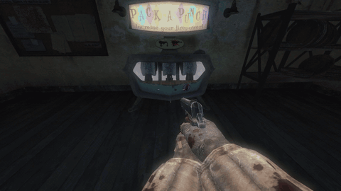
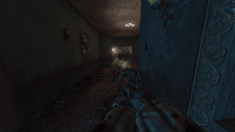
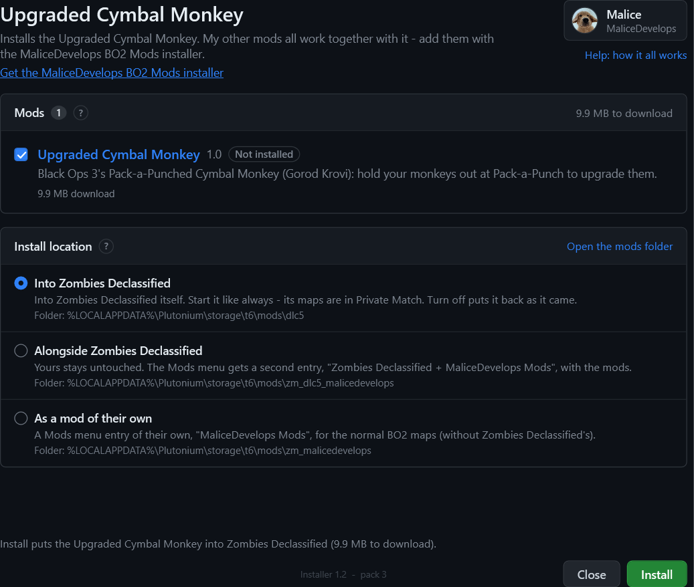

# Upgraded Cymbal Monkey for BO2 Zombies (Plutonium)

Black Ops 3's Pack-a-Punched Cymbal Monkey from Gorod Krovi, in Black Ops 2 Zombies. It brings BO3's own bass pulse, dubstep song, voice lines, glow and bigger explosion.

### [⬇ Download the latest version](https://github.com/MaliceDevelops/upgraded-cymbal-monkey-bo2/releases/latest)

Under **Assets**, download `Upgraded_Cymbal_Monkey_v<version>.zip`.

| Pack-a-Punch your monkeys | The upgraded monkey |
| --- | --- |
|  |  |

## How it works

- **Pack-a-Punch your monkeys.** At a working Pack-a-Punch, hold your Cymbal Monkeys out (hold the button you throw them with), look at the machine and press Use. It costs 5000 (1000 in a Bonfire Sale). The machine plays its show like it does for a gun, then you take **4 upgraded monkeys**.
- **Bass pulse.** Once an upgraded monkey lands, it pulses every second and hurts every zombie close to it, using BO3's damage numbers.
- **Dubstep.** It plays BO3's dubstep song instead of the normal one, with its own voice lines.
- **Bigger explosion:** BO3's radius and damage for the upgraded monkey.
- **Everything else** works like the normal monkey: zombies go for it, and Samantha takes one thrown out of the map.
- **Maps.** It works on every BO2 zombies map with Cymbal Monkeys and a Pack-a-Punch, and on the **Zombies Declassified** maps if you have it.

## Install

1. Close Black Ops 2.
2. Unzip the download anywhere and double-click **Install.bat**.
3. Choose where it goes, press **Install** and play:
   - **Into Zombies Declassified:** launch it like always. It works on its maps (in **Private Match**) and on the normal BO2 maps. To play Zombies Declassified without it, press **Turn off** in the installer (**Turn on** puts it back).
   - **Alongside Zombies Declassified:** your own Zombies Declassified stays exactly as it is, and the Mods menu gets a second entry with the mod. Pick **Zombies Declassified + MaliceDevelops Mods**, then **Private Match** for its maps.
   - **On its own** (the only choice without Zombies Declassified): open **Mods**, pick **MaliceDevelops Mods**, then play any map.

This download installs only the Upgraded Cymbal Monkey. Its window:

Everything happens in that window: it shows the progress, says where the mod is and how to play it, and explains every part - hover over anything, or press **Help**.

The installer stays on your PC: a **MaliceDevelops BO2 Mods** shortcut on your desktop and in the Start menu opens it again, so you don't need to keep the zip.

Install.bat needs Windows 10 or 11 and an internet connection. To install by hand instead, follow `README.txt` in the download.

Windows may warn about running a downloaded `.bat`. Install.bat only downloads my mods from github.com/MaliceDevelops (checking every file's SHA-256) and copies them; you can read `installer\install.ps1` to check.

## Want my other mods too?

They all work together in the same game (like the [Apothicon Servant](https://github.com/MaliceDevelops/apothicon-servant-bo2)). Get the **[MaliceDevelops BO2 Mods installer](https://github.com/MaliceDevelops/bo2-mods-installer/releases/latest)**: tick the mods you want and it downloads each one from its own page.

## Update, repair or move it

Open the **MaliceDevelops BO2 Mods** shortcut (or run Install.bat again). It always installs the newest version, keeps your settings, and doesn't download again what's already up to date. If it acts broken, press **Repair**: it downloads again only what's missing or damaged.

## Uninstall

Close BO2 and double-click **Uninstall.bat** (or press **Uninstall** in the installer). It removes the Upgraded Cymbal Monkey; any other mods of mine stay. It also puts back anything it set aside. The installer and its **MaliceDevelops BO2 Mods** shortcut stay, so you can install again; to remove them too, delete the shortcut and the folder `%LOCALAPPDATA%\MaliceDevelops`.

## Good to know

- **Co-op:** everyone in the game needs the same mods installed.
- **Other mods:** script mods like B2OP work fine alongside. Zombies Declassified has two free slots for mods that bring their own fastfile, and all of my mods together use one, so another fastfile mod can use the other.
- **Small:** all my mods share one small file (a few MB); each mod's textures, scripts and sounds are separate, and only installed mods' files are on your PC. To combine mods, use the [installer](https://github.com/MaliceDevelops/bo2-mods-installer/releases/latest).
- **After a Zombies Declassified update or install:** if upgrading monkeys stops working, open the installer and press **Repair**.
- **Who's Who and Tombstone** give back normal monkeys, not upgraded ones.

## Bugs

Open an [issue](https://github.com/MaliceDevelops/upgraded-cymbal-monkey-bo2/issues). Include:

- the map,
- whether you have Zombies Declassified,
- the lines starting with `MKY >>` from `%LOCALAPPDATA%\Plutonium\storage\t6\main\console_zm.log`.

## Changes

See [CHANGELOG.md](CHANGELOG.md).

## Credits

Made by **MaliceDevelops**. Built with [OpenAssetTools](https://github.com/Laupetin/OpenAssetTools) and [Plutonium](https://plutonium.pw).

The upgraded Cymbal Monkey's effects, song, sounds and voice lines are © Activision / Treyarch, from Call of Duty: Black Ops III. This is a free fan mod, not affiliated with or endorsed by Activision. Don't sell it.
